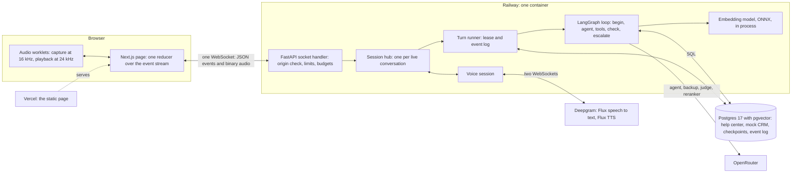
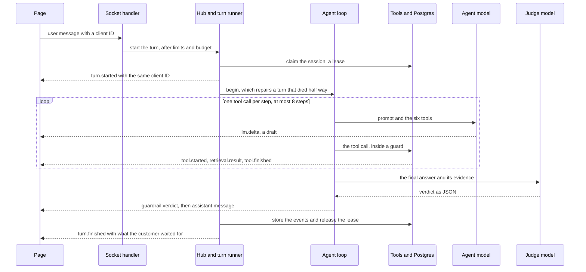
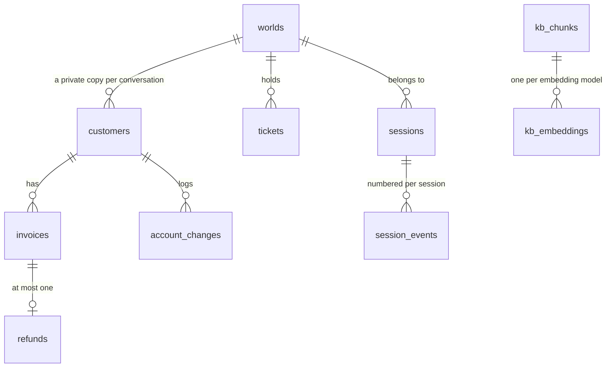
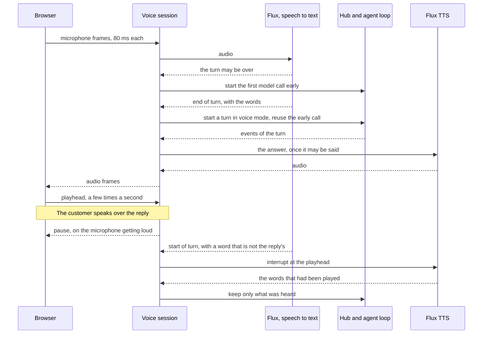

# Architecture

How the support agent is built, and why it is built that way. The [README](README.md) says how to run it, what the page does and what was measured. This file is the map.

## The system in one picture

| Part | What it is | Where |
|---|---|---|
| Page | Next.js 16 and React 19, built statically. One reducer turns events into what is shown. | `frontend/src/lib/state.ts`, `frontend/src/components/` |
| Socket handler | FastAPI. One WebSocket per client at `/ws`, `GET /health`, nothing else. | `backend/src/supportagent/api/app.py` |
| Session hub | One object per live conversation. Runs its turn in the background and fans the events out to up to 4 connections. | `api/hub.py` |
| Turn runner | Runs one turn of the graph and reports it as numbered events. Holds the lease on the session. | `session.py`, `eventlog.py` |
| Agent loop | A LangGraph state machine with a Postgres checkpointer. Five nodes, six tools. | `agent/graph.py`, `agent/tools.py`, `agent/guard.py` |
| Model client | One client for every model call: time limits, retries, backup model, cost. | `llm/client.py` |
| Retrieval | Chunker, hybrid search in one SQL query, reranker, scope gate. | `kb/`, `agent/context.py` |
| Voice session | One more client of the hub: Deepgram's two sockets, turn-taking, interruption. | `voice/session.py`, `voice/deepgram.py` |
| Redactor | Keeps PINs out of everything that is stored or sent. | `redact.py` |
| Mock CRM | Customers, invoices, refunds and tickets, with the business rules as constants. | `crm/` |

Models, as deployed. All of them are settings.

| Role | Model | Through |
|---|---|---|
| Agent | Gemma 4 31B, picked by a bake-off of six on 55 scripted conversations | OpenRouter, pinned to two providers |
| Backup | GPT-6 Luna, on another provider | OpenRouter |
| Grounding judge | Gemini 3.6 Flash, on a third provider, so the agent never grades itself | OpenRouter |
| Reranker | Cohere rerank-5-pro | OpenRouter |
| Embedder | bge-small-en-v1.5, a small ONNX model on the CPU | in the backend process |
| Speech to text | Deepgram Flux, which also decides where a turn ends | Deepgram |
| Text to speech | Deepgram Flux TTS | Deepgram |

## Five decisions that shape the rest

**1. One pipeline, two clients.** A typed message and a spoken one start the same kind of turn on the same session, in the same graph, behind the same guardrails. Voice is an adapter in front: speech to text on the way in, text to speech on the way out. The alternative was a speech-to-speech API, which keeps its own context and makes its own tool calls. Memory would then have to be synchronised between two agents and every guardrail written twice. With one pipeline, an identity check done by voice holds for a typed question after it, because there is only one conversation.

**2. The page is a fold over an event stream.** Every step of a turn is a typed event with a sequence number: a model call starting, a token, a tool starting and finishing, a search result with its scores, the verdict of the grounding check. The events are stored in Postgres. The page is one reducer over them, and a reload replays them through the same reducer. Live step status, reconnecting without loss and the observability drawer are then one mechanism and not three, and the drawer cannot disagree with the chat.

**3. A turn belongs to the session, not to the socket.** The hub runs the turn as a background task. If the browser goes away the turn finishes and is stored, and the client that comes back says the last number it saw and gets the rest. The process that runs a turn holds a lease on the session in Postgres and renews it every 15 seconds. A second instance cannot take the turn, and the turn of a process that died is free after 45 seconds.

**4. The prompt asks, the code enforces.** Who the customer is and which plan they are on come from session state, never from the model's arguments. Account tools refuse until `verify_identity` has succeeded. Refund windows and limits are constants in `crm/policy.py`, and the refund runs in a transaction that locks the customer row. The scope gate and the grounding check are code. A model that is talked into something still cannot do it.

**5. Nothing is the answer before its check.** Tokens stream to the screen as a draft. The event that says "this is the answer", the stored copy and the prompt traces all come after the judge's verdict. An answer that fails is taken off the screen. Speech cannot be taken back, so a spoken answer that rests on a tool waits for its verdict before a word of it is said.

## Life of a turn

The loop has five nodes.

- `begin` resets the turn's working memory and repairs the conversation if the last turn stopped half way: a tool call without a result gets one, an answer that never passed its check is removed.
- `agent` calls the model with the six tools and keeps the first tool call of the reply. Text a model writes on the way to a tool call is dropped.
- `tools` runs the call inside a guard: a timeout of 8 seconds, up to 3 attempts for failures that may pass, and every other failure turned into an error the model can read. The guard is what emits the step events, so the page shows exactly what ran.
- `check` sends the final answer to the judge with everything the tools returned in this turn.
- `escalate` opens a ticket and replies with fixed wording that no model wrote. It runs when a search found nothing, when the check failed, or when the loop used its 8 steps.

LangGraph saves the state in Postgres after every node. That is the memory across turns, and what a retry resumes from.

| Tool | Does | Enforced in code |
|---|---|---|
| `verify_identity` | Checks an account number and a PIN | Three wrong PINs lock the conversation and open a ticket. A call without a PIN is no attempt. |
| `get_account` | Reads plan, status, seats, renewal, invoices | Needs a verified customer |
| `search_knowledge_base` | Searches the help center | Only passages the customer's plan may see. Returns a band, see below. |
| `issue_refund` | Refunds one invoice in full | Window, limit, status and duplicates, in one locked transaction, at most once per invoice |
| `update_account_field` | Changes one of four contact fields | Validates the value. No other field can change. |
| `create_escalation_ticket` | Hands the case to a person | One ticket per call, also when the call is retried |

## Retrieval and the scope gate

Ingest. Sixteen Markdown documents become 96 chunks. The chunker follows the heading tree: a chunk never crosses a heading, carries its heading path, and is never cut inside a table, a numbered procedure or a code block. A comment under a heading says which plans a section is for. A table is kept as Markdown for display and spelled out row by row for search. Ingest is idempotent: a second run writes nothing.

Search is one embedding, one SQL query and one rerank call.

1. The query is embedded in process.
2. One SQL statement ranks the chunks twice, by vector distance in pgvector and by full-text match, and fuses the two rankings by reciprocal rank. It does this once among the chunks the customer's plan may see and once among the rest: 20 candidates from the first group, 8 from the second.
3. The hosted reranker scores all 28 in one call. The 5 best visible chunks go to the model. Of the other group only the best score and its plans leave the retriever, never the text.

The table has no approximate index. At 96 chunks an exact scan takes a few milliseconds, and an index would add a recall problem to solve nothing.

The gate turns the two scores into one of five bands.

| Band | When | What happens |
|---|---|---|
| `answer` | The best visible chunk scores at or above the high threshold | The answer streams and is checked afterwards |
| `check` | Between the thresholds | The answer is held back until the check has passed |
| `verify` | Nobody is verified, and a chunk for some plan answers far better than anything public | The agent asks for the account number and PIN, and learns nothing else |
| `restricted` | The customer is verified, and another plan's chunk is a confident match | The agent says the topic belongs to another plan |
| `escalate` | Nothing reaches the low threshold | A ticket and the hand-off text |

The thresholds belong to the reranker and were calibrated on 110 labelled questions, 42 of them written by outside reviewers.

## Guardrails

Four layers, each for what the one before cannot see.

| Layer | Catches | Where |
|---|---|---|
| Scope gate | A question the help center has nothing on | `agent/context.py`, `agent/tools.py` |
| Grounding check | A question the documents only come close to, and any statement the evidence does not support | `agent/judge.py`, `agent/graph.py` |
| State preconditions | An account action without a verified identity, a plan the customer is not on | `agent/tools.py` |
| Policy in code | A refund outside its window or above its limit, a second refund of one invoice | `crm/policy.py`, `crm/repo.py` |

A relevance score cannot tell a question the documents answer from one they only resemble. "What was your uptime last month?" finds the page on the uptime commitment and scores high. That is the judge's job. It gets the answer, the tool results of the turn, who the customer is and what the tools can do, and returns JSON: is every statement supported, and does the reply say the help center lacks something the customer asked about. The first finding withdraws the answer. The second opens a ticket, so nobody is left with "we have no answer" and no one to follow up.

The request to the judge wraps evidence, customer text and reply in tags that carry a one-time code. A customer cannot type something that reads as evidence. If the judge is down the answer is withheld and the turn fails as retryable. It never fails open.

PINs. The model has to see a PIN to pass it to the tool, and nothing else should. One redactor per session masks it in every event, trace, ticket and search query, and removes it from the stored conversation once the tool has used it. The session stores keyed hashes of the PINs it has seen, so a process that picks the session up later masks the same values.

## Sessions, events and storage

Everything durable is in one Postgres database.

- Help center: `kb_chunks` with a generated `tsvector` column, and `kb_embeddings`.
- Mock CRM: every conversation gets a world, a private copy of the customers and invoices. One reviewer's refund does not exist for the next reviewer, and eval scenarios cannot disturb each other.
- Conversation state: LangGraph's checkpoint tables. Only the newest saved state of a conversation is kept.
- `sessions`: the stream position, the lease (`turn_owner`, `turn_heartbeat_at`), the last activity, the hashes of PINs, and what the customer had heard of a spoken reply they cut off.
- `session_events`: the event log. Token deltas are numbered and not stored. Prompt traces are stored and not streamed: the page fetches them when their tab is opened.

Reconnecting. The client's first message says the last sequence number it saw. The hub subscribes it, then merges four sources read at one moment: stored events, events a save has not written yet, the events of the turn in flight, and what arrived meanwhile. A marker ends the replay, and the live stream follows, each event exactly once. Every message carries a client ID that its turn hands back, so after a reconnect the page knows whether its last message arrived. If not, the text goes back into the field. It is never sent twice behind the visitor's back.

The session ID is the only key to a conversation. The browser keeps it, so a reload or a second tab continues the same one.

## When things fail

| Failure | What the backend does | What the visitor sees |
|---|---|---|
| A model is slow or errors | Four time limits: 8 s to the first token, 10 s between chunks, 45 s an attempt, 90 s for the call. Up to 3 attempts with backoff, `Retry-After` obeyed, a retry budget per model. | "Rate limited. Trying again in 1.2 s, attempt 2 of 3" |
| The model stays down | The backup model on another provider takes over | "Switched to the backup model" |
| Every model is down | The turn fails as retryable. The saved state is intact. | A card with Try again, which resumes after the last finished step |
| An error in the middle of a stream | Handled like one at the start. The half answer is reset. | The draft is cleared and written again |
| A tool fails | Retried when it may pass. Otherwise the model reads the error and says so or opens a ticket. | The step row shows the retry |
| The judge is down | The answer is withheld and the turn fails. A retry reruns the check and nothing else. | The answer is taken off the screen |
| The client drops | The turn finishes and is stored | After reconnecting, everything it missed |
| A deploy in the middle of a turn | The old process stops its turns and stores them. The lease keeps the new one off a running turn. | A stopped turn with Resume |
| The speech service fails | One reconnect, then voice turns off | "Voice is off", and the conversation goes on in text |

A panel in the drawer queues each of these for the visitor's own session. A simulated failure raises inside the same code path as a real one, so what the demo shows is the real handling.

Cost is bounded in three places. One address can start 30 conversations an hour. The app stops new turns when the stored model cost of the last 24 hours reaches a daily budget, and speech has a budget of its own. The provider key has a hard cap.

## Voice

The voice session sits on the hub next to the connections that read its events. It takes one thing at a time from one queue: a message of the recogniser, an event of the turn, a report of the player, a tick. Four rules decide what it does.

1. Nothing unconfirmed is spoken. An answer that rests on a tool is said after its check. While the tool runs the customer hears one sentence of the app's own, such as "Let me check that for you."
2. The customer can always interrupt, by speaking, a Stop button, the space bar or Escape. Playback pauses on the microphone getting loud, about a fifth of a second after they start, and is cancelled once the recogniser has a word that is not the reply's own.
3. What was cut off is remembered as far as it was heard. The voice is told where playback stood and says which words that was. The next turn, spoken or typed, puts those words into the conversation in place of the full reply.
4. Numbers get time. While an account number or a PIN is being said, the recogniser writes digits as numerals and waits out pauses.

Two things make it answer sooner. Flux says early that a turn may be over, and the agent's first model call goes out on that signal with exactly the prompt the turn would send. If the turn ends on the same words it takes that call, which saves a quarter of a second at the median. And a model call that has sent no token after 0.45 s is sent a second time, with the faster of the two used, because the slow starts of the model were most of the 95th percentile.

What voice costs is bounded like the rest: 4 lines per process, 2 per address, an hour a day per address, ten minutes a session, and a daily speech budget.

## Observability

The drawer reads the same state as the chat. Per turn it shows end-to-end time, the three waits a customer feels (first sign of work, first text, approved answer), tokens, cost, a timeline with a bar per model and tool call, every search with its band, scores and thresholds, the grounding verdict, and the prompts as they were sent, with PINs masked.

Cost is computed where it arises. Model calls are tokens times the configured price. The reranker reports its own cost per search. Speech is minutes heard and characters spoken at list prices. A call that was cut short reports no usage, so it is counted at a fixed amount and not at zero: stopping turns is no way around the budget.

## Deployment and continuous integration

- Frontend on Vercel, a static build. The only setting is the backend's address, read at build time. A content security policy names that address as the only place the page may connect to.
- Backend on Railway, from the repo's `Dockerfile`. The image runs as a user that owns nothing but the model cache. Starting applies the migrations and loads the help center under an advisory lock, so two containers that start together do the work once. `/health` answers once the database is reachable and the embedding model is loaded.
- Postgres on Railway, the `pgvector/pgvector:pg17` image with a volume.
- CI on every push, three jobs: backend lint and tests against a pgvector service, frontend type check, lint, tests and build, and a start of the image in 1 GB that checks it is healthy, not root and serves no API docs.

Tests use the real graph, tools, database and retrieval with a scripted model in place of an LLM. Voice tests run against a stand-in for Deepgram's two sockets on a local port. No test calls a paid model.

## What I would change for a real product

- Limits per address live in one process's memory. Several instances need them in Postgres or Redis. The budgets and the lease already are.
- One instance serves the demo. The lease keeps two instances off one turn, and two gaps remain for overlapping workers: a worker that lost its lease can still announce its last event to its own clients, and a voice event can get one number live and another on replay.
- Identity is an account number and a PIN typed into a chat. A product would use the session of a signed-in user.
- The CRM is a set of fixtures. The refund path is shaped for a real one: one transaction, and a business key that makes a retry pay at most once.
- A ticket goes into a table and nobody reads it. The human side is the next thing to build: an inbox, ownership, a reply path back to the customer.
- The ticket for an unanswered question depends on two models, the agent and the judge.
- A spoken reply that used no tool is said while it is checked. Holding it would add the judge's time to every such turn.
- Nobody has measured echo with a person on loudspeakers. The guard against the assistant hearing itself compares words and has only run on audio without an echo.
- Prompt traces of earlier turns stay readable after another customer is verified in the same conversation.

## From the brief to the code

| The brief asks for | Where it is | What checks it |
|---|---|---|
| Streaming chat with live step status | `api/app.py`, `agent/guard.py`, `frontend/src/lib/state.ts` | `tests/test_ws.py`, `state.test.ts`, a browser run on the public address |
| Live voice with waveform, transcripts, interruption | `voice/session.py`, `frontend/src/lib/voice.ts`, `frontend/public/worklets/` | `tests/test_voice*.py`, `voice.test.ts`, the scripted caller, a browser with a recording as its microphone |
| Observability drawer | `events.py`, `llm/trace.py`, `frontend/src/components/Drawer.tsx` | `tests/test_trace.py`, `state.test.ts` |
| Vector database with custom chunking | `kb/chunker.py`, `kb/retrieval.py`, `sql/001_init.sql` | `tests/test_chunker.py`, `tests/test_retrieval.py`, `evals/retrieval.py` |
| Confidence guardrails and escalation | `agent/context.py`, `agent/judge.py`, `agent/graph.py` | `tests/test_agent_guardrails.py`, `evals/judge.py`, `evals/retrieval.py` |
| A chain of three or more tool calls | `agent/tools.py`, `agent/graph.py` | `tests/test_agent_tools.py`, `evals/suite.py` with 55 scripted conversations |
| Tool status streamed to the UI | `agent/guard.py`, `events.py` | `tests/test_ws.py` |
| Fallback states for failures | `llm/client.py`, `llm/faults.py`, `frontend/src/lib/reconnect.ts` | `tests/test_llm_client.py`, `reconnect.test.ts`, the Failures tab |
| One memory across text and voice | `session.py`, `eventlog.py`, LangGraph's checkpointer | `tests/test_session.py`, the scripted caller's typed question after a spoken identity check |
| Deployed | `Dockerfile`, `.github/workflows/ci.yml` | CI's start of the image, `/health`, the public address |
