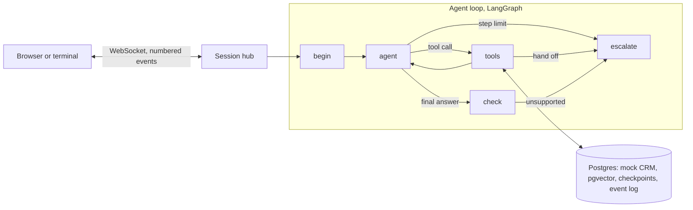

# AI support agent

A customer support agent for Fernhill, an invented B2B SaaS company. It answers from a help center, checks who it is talking to before it touches an account, and can refund an invoice, change a contact field or hand the case to a person. It streams every step to the client as a typed event.

The project follows a brief that asks for streaming chat, live voice, multi-step tool chains, confidence guardrails and real-time observability. It is being built in four phases, and this README changes with every push.

## Status

Phase 1 of 4. The backend exists: the agent, its guardrails, a WebSocket server and the evals. There is no web UI, no voice mode and no deployment yet. No hosted model has run it either, so every number below comes from a local model.

| What the brief asks for | State today |
|---|---|
| Streaming chat UI with live step status | The server streams every step over a WebSocket and two terminal clients print them. The Next.js UI is phase 2. |
| Live voice with waveform, transcripts and interruption | Not started. Phase 3. |
| Observability drawer | The data exists. Each model call reports its prompt, latency, tokens and cost. The drawer is phase 2. |
| Vector database with custom chunking | Done. pgvector and full-text search fused in SQL, a chunker that follows the heading tree, a reranker. |
| Confidence guardrails that route to a person | Done. A gate on the reranker's score, and a second model that checks each answer. The thresholds fit the local reranker only. |
| A chain of three or more tool calls | Done. Six tools, with the business rules in code. |
| Tool start and finish streamed to the UI | Done on the wire. |
| Fallback states for timeouts, rate limits and tool failures | The backend retries, fails over and resumes. The UI states are phase 2. |
| One memory across text and voice | A session is stored under its ID and any client can continue it. Voice does not exist yet. |
| Deployed | No. The plan is Vercel for the frontend, Railway for the backend and Postgres. |

## How a turn runs



1. `begin` stores the customer's message. If the last turn died half way, it first repairs the conversation, so the model never sees a tool call without a result.
2. `agent` calls the model with the six tools. The model makes one tool call per step.
3. `tools` runs the call inside a guard. The guard emits `tool.started` and `tool.finished`, enforces a timeout, retries a failure that may pass, and turns any other failure into an error the model can read.
4. `check` sends the final answer and its evidence to a second model. An answer with an unsupported statement is withdrawn.
5. `escalate` opens a ticket and replies with fixed wording. No model writes that text.

LangGraph saves the conversation in Postgres after every step. The event log is in Postgres too, numbered per session. A turn belongs to the session and not to the socket, so it finishes and is stored even when the client has gone.

Chat and voice are meant to be two clients of this one pipeline. The turn runner already takes a mode, text or voice, and the system prompt changes with it.

## The six tools

| Tool | What it does | Rules the code enforces |
|---|---|---|
| `verify_identity` | Checks an account number and PIN | Three wrong PINs lock the conversation and open a ticket. The count never resets. |
| `get_account` | Reads plan, contract status, seats, renewal date and recent invoices | Needs a verified customer |
| `search_knowledge_base` | Searches the help center, limited to passages the customer's plan may see | Returns a band that decides what happens to the answer. See the scope gate below. |
| `issue_refund` | Refunds one invoice | 14 days for Pro monthly, 30 days otherwise, 90 days for a duplicate charge. Up to $500 on Pro and $2,000 on Enterprise. Anything above goes to the billing team as a ticket. The invoice has to be paid and not yet refunded. No refunds on Free, on a suspended account or on a past-due one. |
| `update_account_field` | Changes the billing email, contact name, contact phone or marketing opt-in | Validates the value. No other field can change. |
| `create_escalation_ticket` | Hands the case to a person | One ticket per call, even when the call is retried |

The model cannot talk its way around these. The limits are constants in `crm/policy.py`, the refund runs in one transaction that locks the customer row, and the account tools refuse until `verify_identity` has succeeded in this conversation.

## Guardrails

### Scope gate

Every search ends in one of five bands. The band comes from the reranker's best score among the passages the customer may see, and from its best score among passages written for other plans.

| Band | When | What happens |
|---|---|---|
| `answer` | The best visible passage scores at or above `GATE_HIGH` | The answer streams as it is written and is checked afterwards |
| `check` | The score is between `GATE_LOW` and `GATE_HIGH` | The answer is held back until the grounding check passes |
| `verify` | The visitor is not verified, and a passage for another plan answers much better than anything public | The agent asks for the account number and PIN. It gets nothing from the hidden passage. |
| `restricted` | The customer is verified, and a passage for another plan is a confident match | The agent says the topic belongs to another plan |
| `escalate` | Nothing scores above `GATE_LOW` | A ticket, and the hand-off text |

The thresholds belong to the reranker. Change the reranker and all three settings need a new calibration with `supportagent.evals.retrieval`.

### Grounding check

A relevance score cannot tell a question the documents answer from a question they only come close to. "What was your uptime last month?" finds the page about the uptime commitment and scores high. So every final answer also goes to a judge model, together with the tool results of the turn, the customer's account and a list of what the tools can do.

The judge returns JSON. An answer with any unsupported statement is withdrawn and the case goes to a person. If the judge is down, the answer is withheld and the turn fails as retryable. The retry reruns the check and nothing else.

The request wraps the evidence, the customer's words and the reply in tags that carry a one-time code, and it marks every line of customer and reply text with who wrote it. A customer cannot type something that reads as evidence.

### PINs

The model has to see the PIN to pass it to `verify_identity`. Nothing else should. A redactor masks it in every event, trace and ticket, and removes it from the stored conversation once the tool has used it. While a visitor is unverified, every number of 4 to 8 digits they type is masked in what the backend stores and sends.

One gap remains. A PIN typed in a message stays in the saved conversation until the model calls the tool.

## When things fail

- A model call has four time limits: until the first token, between two chunks of the stream, for one attempt, and for the whole call with its retries. Rate limits and server errors are retried with backoff, and a `retry-after` header is obeyed. A billing error is not retried, because waiting does not clear it.
- Each model has its own retry budget. When the first model is exhausted, a fallback model on another provider takes over, if one is configured.
- An error that arrives in the middle of a stream is handled like one at the start. The half-written text is dropped and the client gets an `llm.reset` event.
- A tool that keeps failing produces an error the model reads. The model then says so or opens a ticket.
- A client that reconnects sends the last event number it saw. It gets the stored events it missed, then the live stream, each exactly once.
- `turn.cancel` stops a running turn. `turn.retry` resumes a failed turn from its last saved step.
- With `FAULT_INJECTION=true` a client can queue simulated timeouts, rate limits, outages and tool failures for its own session. That is how the failure paths get shown in a demo.

## Run it

You need [uv](https://docs.astral.sh/uv/), Docker, and an OpenAI-compatible chat endpoint. uv installs Python 3.12 by itself. So far this has only run on Linux.

```sh
git clone https://github.com/raghav-rathi/AISupportAgent.git
cd AISupportAgent
cp .env.example .env        # set POSTGRES_PASSWORD, and the same password inside DATABASE_URL
scripts/dev-db.sh up        # Postgres 17 with pgvector, on 127.0.0.1:54329
cd backend
uv sync
uv run python -m supportagent.cli.ingest      # applies the migrations, loads the help center
uv run python -m supportagent.cli.preflight   # says what is missing
uv run pytest -q
```

The tests need the database and no model. They run the real graph, tools and retrieval with a scripted model in place of an LLM. The first run downloads two small ONNX models for embedding and reranking.

Any Postgres with the `vector` extension works in place of the Docker script. Point `DATABASE_URL` at it.

### Pick a model

The agent and the judge each need a chat endpoint. There are two ways to give them one.

Through the Vercel AI Gateway. Set `AI_GATEWAY_API_KEY`. The example file is filled in for this. Nobody has run this path with a real key yet, so start with the check below. It sends one small request to every model and prints what came back.

```sh
uv run python -m supportagent.cli.gateway_check ../evals/candidates.hosted.json
```

Through a local server such as Ollama. This is where all results on this page come from. Replace the `LLM__` and `JUDGE__` lines of `.env` with these:

```sh
LLM__MODEL=qwen3.8:27b-q4_K_M
LLM__BASE_URL=http://127.0.0.1:11434/v1
LLM__API_KEY=ollama
LLM__EXTRA_BODY={"reasoning_effort":"none"}
JUDGE__MODEL=qwen3.8:27b-q4_K_M
JUDGE__BASE_URL=http://127.0.0.1:11434/v1
JUDGE__API_KEY=ollama
JUDGE__EXTRA_BODY={"reasoning_effort":"none"}
LLM_FIRST_TOKEN_TIMEOUT_S=120
LLM_TOTAL_TIMEOUT_S=240
LLM_DEADLINE_S=300
```

The three limits above suit a 24 GB GPU. On a slower machine raise `LLM_STALL_TIMEOUT_S` too. It is the longest silence allowed inside a stream, 10 seconds by default, and a local server sends a tool call in one piece, so the stream is silent for as long as the call takes to write.

A judge on the same model as the agent is good enough to try things out. In production it would approve its own mistakes, so the example file puts the judge on another provider.

### Talk to it

```sh
uv run python -m supportagent.cli.chat --verbose      # the agent inside this process

../scripts/dev-server.sh up                           # or a server on 127.0.0.1:8787
uv run python -m supportagent.cli.ws_chat --verbose   # and a client on its WebSocket
../scripts/dev-server.sh down
```

Both clients print every event: tool steps, the band of each search, the verdict of the grounding check, retries, tickets.

### Demo accounts

Each session gets a private copy of this data. A refund in one session does not exist in the next.

| Account | PIN | Customer | Plan | Try |
|---|---|---|---|---|
| 10482917 | 4721 | Maya Okafor, Larkspur Design Co | Pro, monthly | Refund INV-30417, which is 5 days old. INV-29880 is 35 days old and outside the window. |
| 20573846 | 9034 | Daniel Reyes, Quillon Freight | Pro, annual | Refund INV-30388. At $1,440 it is above the $500 limit and goes to billing. |
| 31764025 | 1586 | Priya Natarajan, Brindle & Wye Accounting | Pro, monthly | Charged twice for one period, INV-30212 and INV-30213 |
| 53920164 | 2458 | Elena Sokolova, Harrowgate Robotics | Enterprise | INV-30390 is a $900 add-on and refundable. INV-30402 is $4,500 and above the limit. |
| 64037291 | 8815 | Marcus Bell, Ostrander Health Systems | Enterprise, suspended | Nothing is refunded or changed in chat |
| 75148302 | 3390 | Jun Watanabe, Pellam Studio | Free | No refunds on this plan |

Six more accounts are in `backend/src/supportagent/crm/fixtures.py`.

## Evals

```sh
uv run python -m supportagent.evals.retrieval ../evals/retrieval_dev.jsonl ../evals/retrieval_heldout.jsonl
uv run python -m supportagent.evals.judge --runs 3
uv run python -m supportagent.evals.suite
uv run python -m supportagent.evals.bakeoff ../evals/candidates.hosted.json
```

- `retrieval` measures ranking and the scope gate on labeled questions. One set of 68 questions was written alongside the documents. Outside reviewers wrote a second set of 42.
- `judge` runs the grounding judge on 44 replies whose right verdict is known. Half are correct, half carry one seeded error.
- `suite` runs 55 scripted conversations against the configured model and checks which tools ran, what the database holds afterwards and what the agent said.
- `bakeoff` runs the suite for several candidate models and picks one by a rule fixed in advance: at least 95% of scenarios, then the fastest tool chain, then the lower cost.

### Results so far

| Check | Result |
|---|---|
| Tests | More than 300 pass |
| Scenario suite, 55 conversations | 53 of 55 in the last full run. Both failures have been fixed since, and the rerun on the current code is not finished. |
| Grounding judge, 44 replies | No false alarm on 22 correct replies and no miss on 22 seeded errors, in one run |
| Retrieval, own questions | The right section is in the top 5 for 50 of 50, and first for 46 |
| Scope gate, own questions | 2 of 50 answerable questions escalated. 1 of 5 off-topic and 2 of 13 near-miss questions pass the low threshold. |
| Scope gate, reviewers' questions | 2 of 26 answerable questions escalated. 3 of 4 off-topic and 6 of 9 near-miss questions pass the low threshold. |

Read these with care.

- The model is a 4-bit Qwen3.8-27B on one GPU, and it judged its own answers. No hosted model has run.
- The scenarios, the judge cases and the prompts have one author, and the prompts were tuned against the scenarios.
- The gate does not hold on the reviewers' questions with the small local reranker. A question that passes the low threshold still has to pass the grounding check, but the gate should not lean on that. The hosted rerankers are the next thing to measure.

## WebSocket protocol

One socket per client, at `/ws`. The client speaks first.

| Client sends | For |
|---|---|
| `hello` | Opens a new session or resumes one. Carries the last event number the client saw. |
| `user.message` | Starts a turn |
| `turn.retry` | Resumes a failed turn |
| `turn.cancel` | Stops the running turn |
| `fault.inject` | Queues a simulated failure, when the server allows it |

The server answers with events, each with a sequence number:

- session: `session.ready`, `session.state`, `error`
- turn: `turn.started`, `turn.finished`, `turn.failed`, `turn.interrupted`
- model: `llm.started`, `llm.delta`, `llm.reset`, `llm.retry`, `llm.fallback`, `llm.finished`, `llm.trace`
- tools: `tool.started`, `tool.retry`, `tool.error`, `tool.finished`
- guardrails: `retrieval.result`, `guardrail.verdict`, `answer.retracted`, `escalation.created`
- reply: `assistant.message`

`frontend/src/lib/protocol.ts` holds the TypeScript types. `python -m supportagent.cli.gen_types` writes that file from the pydantic models in `events.py` and `api/protocol.py`, and a test fails when it is stale.

## Layout

```text
backend/src/supportagent/
  agent/      the graph, the six tools, the tool guard, the judge, prompts, tickets
  api/        FastAPI app, session hub, client messages
  crm/        mock customers, policy constants, queries, per-session worlds
  kb/         chunker, ingest, hybrid retrieval, local and hosted embedders and rerankers
  llm/        one client for every model call: retries, budget, deadline, fallback, faults, cost
  evals/      retrieval, judge, scenario suite, bake-off
  cli/        preflight, ingest, chat, ws_chat, gen_types, gateway_check
  sql/        forward-only migrations
  redact.py   keeps PINs out of what is stored and sent
  session.py  runs one turn and reports it as events
  eventlog.py numbers a session's events and stores them
backend/tests/   the tests
kb/              16 help center documents, 96 chunks after ingest
evals/           question sets and bake-off candidate files
frontend/        the generated protocol types, and nothing else yet
scripts/         dev database and dev server
```

## What comes next

1. Finish phase 1 with hosted models: the bake-off, the reranker and embedding comparison, final gate thresholds, and the judge on another provider than the agent.
2. Phase 2: the Next.js chat UI, the observability drawer, the failure states, and the first deploy.
3. Phase 3: voice through the same session, with Deepgram Flux for speech to text and text to speech.
4. Phase 4: hardening and the write-up.

## Known gaps

- The backend has no rate limit on new sessions. The only check on a browser is an origin allowlist.
- The wrong-PIN lockout counts per conversation. A new conversation starts a new count.
- The scope gate needs a better reranker, as the results above show.
- The CRM is a set of fixtures. Nothing here talks to a real billing system.
