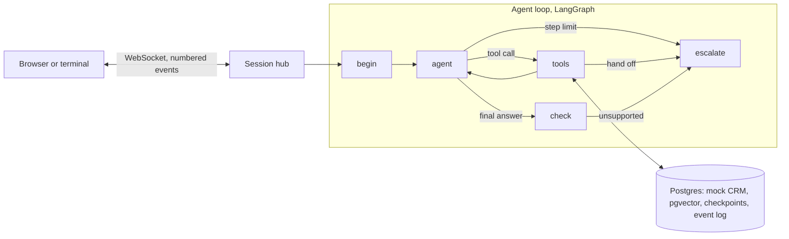
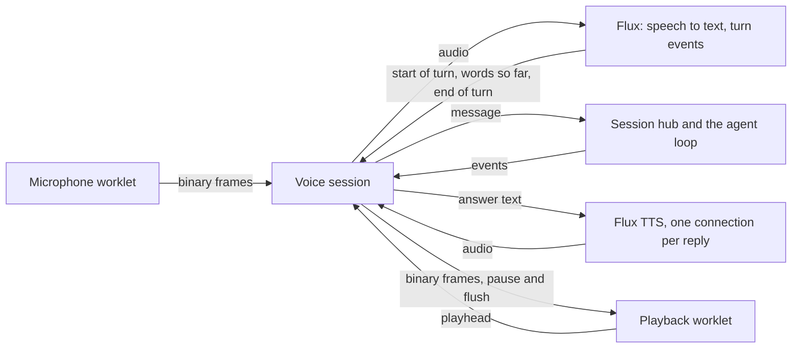

# AI support agent

A customer support agent for Fernhill, an invented B2B SaaS company. It answers from a help center, checks who it is talking to before it touches an account, and can refund an invoice, change a contact field or hand the case to a person. It streams every step to the client as a typed event.

The project follows a brief that asks for streaming chat, live voice, multi-step tool chains, confidence guardrails and real-time observability. It is being built in four phases, and this README changes with every push.

## Status

Phase 3 of 4, voice, is built and deployed. Try it at **https://fernhill-support.vercel.app**: the microphone button is next to Send. The chat UI and the backend run on hosted models, speech runs on Deepgram. After it was deployed the phase was audited twice: by its author with four independent reviews of the code, the measurements and what this file claimed, and by two outside teams who wrote scripts that reproduce what they found. The code that is here has the fixes for both. Four of them changed how voice works. The model starts on a spoken message before the recogniser has called it finished. Playback pauses on the microphone getting loud, before the recogniser has a word. A spoken answer that rests on a tool is said only after its grounding check, and the customer hears "one moment" while the tool runs. And whether the microphone is hearing the reply or the customer is decided on the words the player has reached, not on the whole reply. What was measured before and after is under [Voice, measured](#voice-measured). No person has talked to it on loudspeakers and headphones yet: that session is the project owner's.

| What the brief asks for | State today |
|---|---|
| Streaming chat UI with live step status | Done, in Next.js over a WebSocket. Each tool shows as a step while it runs and with its result once it is done. |
| Live voice with waveform, transcripts and interruption | Done. The backend hears the customer through Deepgram Flux and speaks through Deepgram Flux TTS. The page has a microphone button, a level meter for each side, the customer's words as they are recognised, and four ways to interrupt a reply: speaking, a Stop button, the space bar and Escape. A reply that was cut off is kept only as far as the customer heard it. |
| Observability drawer | Done. Per turn: end-to-end latency, what the customer waited for (first sign of work, first text, approved answer), tokens, estimated cost with the hosted reranker included, a timeline of every model and tool call, retrieval scores, the grounding verdict, and the full prompts with PINs masked, fetched when their tab is opened. For a spoken turn also the wait for the end of the turn, the voice's first sound, voice-to-voice time, the cost of speech, how long before the turn its first model call began, and whether a request was sent twice. Per session, the model calls that were started early and not used. |
| Vector database with custom chunking | Done. pgvector and full-text search fused in SQL, a chunker that follows the heading tree, a reranker. |
| Confidence guardrails that route to a person | Done. A gate on the reranker's score, a second model that checks each answer, and a ticket for a Fernhill question the help center does not answer. |
| A chain of three or more tool calls | Done. Six tools, with the business rules in code. |
| Tool start and finish streamed to the UI | Done. |
| Fallback states for timeouts, rate limits and tool failures | Done. The UI shows a retry, a switch to the backup model, a failed turn with Try again, a stopped turn with Resume, and a dropped connection. A panel can inject each failure on demand. |
| One memory across text and voice | Done. A session is stored under its ID. The browser keeps the ID, so a reload or a second tab continues the conversation. A spoken message and a typed one start the same kind of turn on the same session: an identity check done by voice holds for a typed question after it. |
| Deployed | Yes. The frontend is on Vercel, the backend and Postgres with pgvector on Railway. CI runs the tests, the frontend build and a start of the image on every push. |

## How a turn runs



1. `begin` stores the customer's message. If the last turn died half way, it first repairs the conversation, so the model never sees a tool call without a result.
2. `agent` calls the model with the six tools. The model makes one tool call per step.
3. `tools` runs the call inside a guard. The guard emits `tool.started` and `tool.finished`, enforces a timeout, retries a failure that may pass, and turns any other failure into an error the model can read.
4. `check` sends the final answer and its evidence to a second model. Nothing tells the client "this is the answer" before that verdict. An answer with an unsupported statement is withdrawn. If the customer had seen or heard none of it, the reply says it could not be confirmed, and takes nothing back. An answer that stands and says the help center lacks something gets a ticket added, and the turn ends as escalated.
5. `escalate` opens a ticket and replies with fixed wording. No model writes that text. If the turn had already refunded or changed something, the reply says so.

LangGraph saves the conversation in Postgres after every step. The event log is in Postgres too, numbered per session. A turn belongs to the session and not to the socket, so it finishes and is stored even when the client has gone.

One process runs a session's turn at a time. It holds a lease in Postgres and renews it while the turn runs. A second instance, as during a deploy, cannot take the turn, and the turn of an instance that died is free again after 45 seconds.

Chat and voice are two clients of this one pipeline. The turn runner takes a mode, text or voice, and the system prompt changes with it: a spoken reply is short, has no lists or citation numbers, and names an invoice by date and amount.

## The six tools

| Tool | What it does | Rules the code enforces |
|---|---|---|
| `verify_identity` | Checks an account number and PIN | Three wrong PINs lock the conversation and open a ticket. The count never resets. |
| `get_account` | Reads plan, contract status, seats, renewal date and recent invoices | Needs a verified customer |
| `search_knowledge_base` | Searches the help center, limited to passages the customer's plan may see | Returns a band that decides what happens to the answer. See the scope gate below. |
| `issue_refund` | Refunds one invoice | 14 days for Pro monthly, 30 days otherwise, 90 days for a duplicate charge. Up to $500 on Pro and $2,000 on Enterprise. Anything above goes to the billing team as a ticket. The invoice has to be paid and not yet refunded. No refunds on Free, on a suspended account or on a past-due one. |
| `update_account_field` | Changes the billing email, contact name, contact phone or marketing opt-in | Validates the value. No other field can change. |
| `create_escalation_ticket` | Hands the case to a person | One ticket per call, even when the call is retried |

The model cannot talk its way around these. The limits are constants in `crm/policy.py`, the refund runs in one transaction that locks the customer row, and the account tools refuse until `verify_identity` has succeeded in this conversation.

## Guardrails

### Scope gate

Every search ends in one of five bands. The band comes from the reranker's best score among the passages the customer may see, and from its best score among passages written for other plans.

| Band | When | What happens |
|---|---|---|
| `answer` | The best visible passage scores at or above `GATE_HIGH` | The answer streams as it is written and is checked afterwards |
| `check` | The score is between `GATE_LOW` and `GATE_HIGH` | The answer is held back until the grounding check passes |
| `verify` | The visitor is not verified, and a passage for another plan answers much better than anything public | The agent asks for the account number and PIN. It gets nothing from the hidden passage. |
| `restricted` | The customer is verified, and a passage for another plan is a confident match | The agent says the topic belongs to another plan |
| `escalate` | Nothing scores above `GATE_LOW` | A ticket, and the hand-off text |

A search tries two wordings: the model's query, then the customer's own words without the sentences that only give an account number or a PIN. The better result stands.

`restricted` needs a confident match because the reply states a fact about the customer's plan. A weak match for another plan goes to a person.

The thresholds belong to the reranker. Change the reranker and all three settings need a new calibration with `supportagent.evals.retrieval`.

### Grounding check

A relevance score cannot tell a question the documents answer from a question they only come close to. "What was your uptime last month?" finds the page about the uptime commitment and scores high. So every final answer also goes to a judge model, together with everything the tools returned in this turn, the latest account data, who the customer is and what the tools can do.

The judge returns JSON with two findings.

1. Whether every statement is supported. An answer with any unsupported statement is withdrawn and the case goes to a person.
2. Whether the reply says that the help center lacks something the customer asked about Fernhill. The prompt asks the agent to open a ticket for such a question. When the reply stands and the turn has no ticket, the turn opens one and adds it to the reply. A question that has nothing to do with Fernhill is declined without a ticket.

If the judge is down, the answer is withheld and the turn fails as retryable. The retry reruns the check and nothing else.

The answer event, the stored copy and the prompt traces all come after the verdict. A turn stopped during the check leaves no unchecked answer behind, and the text of a rejected answer is in no trace.

The request wraps the evidence, the customer's words and the reply in tags that carry a one-time code, and it marks every line of customer and reply text with who wrote it. A customer cannot type something that reads as evidence. A tool call that did not run reaches the judge as its error code only, so text a model put into a bad call cannot pass as evidence either.

### PINs

The model has to see the PIN to pass it to `verify_identity`. Nothing else should. A redactor masks it in every event, trace, ticket and search query. It removes it from the stored conversation once the tool has used it, and again when the turn ends, in case the model repeated it. It knows a PIN however it is written: with spaces or other characters between the digits, spelled out, or partly in numerals and partly in words. It learns whatever `verify_identity` is given as one, also under a wrong argument name. While a visitor is unverified, every number of 4 to 7 digits they type is masked in what the backend stores and sends, unless it reads as an amount, a date, a count or an ID.

A spoken PIN needs more than that, because speech arrives a digit at a time and the page shows the words as they are recognised. A PIN said alone is "4", then "4 7", then "4 7 2", before it is four digits. So what is recognised goes through the redactor at every step, and three more rules apply to the customer's own words. A number of any length is masked when a word such as "PIN" stands before it, or an account number does. While the customer has been asked for the account number and the PIN, or has started to give them, every number of up to 7 digits is masked, and what follows the eighth digit of a longer one. And while nobody is verified, a spoken message that is nothing but a number is masked from its first digit. An audit of the first version found the first three digits of a PIN on the page for a moment in most cases. `evals.speech pins` now checks every transcript the recogniser sends on the way, 1,572 of them over 20 clips heard four ways. A digit of the PIN could be read in one: the recogniser wrote "The dentist three" for "The PIN is three", for a quarter of a second. That case is fixed and is a test.

A conversation that another process picks up later still masks its PINs. The session stores keyed hashes of them, never the PINs, and the new process tries every stretch of digits or number words that its mask would cover against those hashes.

Two gaps remain. A PIN typed in a message stays in the saved conversation until the model calls the tool. If it never does, the PIN is masked when the next turn ends. And a customer who says a PIN in two halves, in two messages, with no word that names it and without having been asked, has the halves masked on the page and in the stored events, and in the saved conversation only once the model has used the whole PIN.

## When things fail

- A model call has four time limits: until the first token, between two chunks of the stream, for one attempt, and for the whole call with its retries. Rate limits and server errors are retried with backoff, and a `retry-after` header is obeyed. A billing error is not retried, because waiting does not clear it.
- Each model has its own retry budget. When the first model is exhausted, a fallback model on another provider takes over, if one is configured.
- An error that arrives in the middle of a stream is handled like one at the start. The half-written text is dropped and the client gets an `llm.reset` event.
- A tool that keeps failing produces an error the model reads. The model then says so or opens a ticket.
- A client that reconnects sends the last event number it saw. It gets the stored events it missed, a marker where the replay ends, then the live stream, each event exactly once.
- Every message carries an ID that its turn hands back. After a reconnect the page knows whether its last message arrived. If not, the text goes back into the field. It is never sent twice behind the visitor's back.
- `turn.cancel` stops a running turn. `turn.retry` resumes a failed or stopped turn from its last saved step, at most 3 times per turn.
- The server closes a connection with a code that says what to do next: come back at once after falling behind, come back when the visitor returns after idling, wait after too many conversations, start a new conversation when the old one has expired. The page follows the code.
- With `FAULT_INJECTION=true` a client can queue simulated timeouts, rate limits, outages and tool failures for its own session. That is how the failure paths get shown in a demo, and it is on at the public address.
- When the speech service fails, voice turns off with a message and the conversation goes on in text. The Voice section says what is retried first.
- One address can start 30 conversations an hour and hold 12 connections. A conversation takes 60 messages and 4 connections. `DAILY_BUDGET_USD` stops new turns once the stored model cost of the last 24 hours reaches it. A model call that was cut short reports no usage, so it is stored as a call of unknown cost and counted at a fixed amount: stopping turns is no way around the budget. A conversation is kept for at least a day after its last use, whatever `SESSION_TTL_HOURS` says: the budgets are read from the stored events, and a conversation purged sooner would take its spend along.
- Voice has limits of its own, because an open microphone is paid for by the second whether anyone speaks or not. One address can hold 2 of the 4 voice lines, turn voice on 6 times a minute, and use an hour of it in 24 hours. `DAILY_SPEECH_BUDGET_USD` is the stored cost of speech in 24 hours, 3 dollars unless set otherwise: at that limit voice does not come on, a voice session that is on ends within half a minute, and typed messages go on. All are settings, and the page says so when the server turns it away.
- `/health` answers once the database is reachable and the embedding model is loaded, so a host that waits for it sends no visitor to a process that is still starting.

## Run it

You need [uv](https://docs.astral.sh/uv/), Docker, and an OpenAI-compatible chat endpoint. uv installs Python 3.12 by itself. So far this has only run on Linux.

```sh
git clone https://github.com/raghav-rathi/AISupportAgent.git
cd AISupportAgent
cp .env.example .env        # set POSTGRES_PASSWORD, and the same password inside DATABASE_URL
scripts/dev-db.sh up        # Postgres 17 with pgvector, on 127.0.0.1:54329
cd backend
uv sync
uv run python -m supportagent.cli.ingest      # applies the migrations, loads the help center
uv run python -m supportagent.cli.preflight   # says what is missing
uv run pytest -q
```

The tests need the database and no model. They run the real graph, tools and retrieval with a scripted model in place of an LLM. The first run downloads two small ONNX models for embedding and reranking.

Any Postgres with the `vector` extension works in place of the Docker script. Point `DATABASE_URL` at it.

### Pick a model

The agent and the judge each need a chat endpoint. There are two ways to give them one.

Through OpenRouter. Set `OPENROUTER_API_KEY`. The example file is filled in for this. Start with the check below. It reads each provider's recent uptime from OpenRouter's public listing, then sends one small request to every model and prints what came back.

```sh
uv run python -m supportagent.cli.gateway_check ../evals/candidates.hosted.json
```

Through a local server such as Ollama. Replace the `LLM__` and `JUDGE__` lines of `.env` with these, and leave `RERANK_MODEL` and the three `GATE_` lines out:

```sh
LLM__MODEL=qwen3.8:27b-q4_K_M
LLM__BASE_URL=http://127.0.0.1:11434/v1
LLM__API_KEY=ollama
LLM__EXTRA_BODY={"reasoning_effort":"none"}
JUDGE__MODEL=qwen3.8:27b-q4_K_M
JUDGE__BASE_URL=http://127.0.0.1:11434/v1
JUDGE__API_KEY=ollama
JUDGE__EXTRA_BODY={"reasoning_effort":"none"}
LLM_FIRST_TOKEN_TIMEOUT_S=120
LLM_TOTAL_TIMEOUT_S=240
LLM_DEADLINE_S=300
```

The three limits above suit a 24 GB GPU. On a slower machine raise `LLM_STALL_TIMEOUT_S` too. It is the longest silence allowed inside a stream, 10 seconds by default, and a local server sends a tool call in one piece, so the stream is silent for as long as the call takes to write.

A judge on the same model as the agent is good enough to try things out. In production it would approve its own mistakes, so the example file puts the judge on another provider.

### Talk to it

In a terminal:

```sh
uv run python -m supportagent.cli.chat --verbose      # the agent inside this process

../scripts/dev-server.sh up                           # or a server on 127.0.0.1:8787
uv run python -m supportagent.cli.ws_chat --verbose   # and a client on its WebSocket
../scripts/dev-server.sh down
```

Both clients print every event: tool steps, the band of each search, the verdict of the grounding check, retries, tickets.

In the browser. You need Node 20 or newer, and the backend running as above. Add the page's address to the backend's `.env` first, as `ALLOWED_ORIGINS=["http://localhost:3000"]`, and `FAULT_INJECTION=true` if you want the panel that simulates failures.

```sh
cd frontend
npm install
npm run dev          # http://localhost:3000, talks to ws://localhost:8787/ws
npm test             # the reducer and the reconnect rules
```

`NEXT_PUBLIC_WS_URL` points the page at another backend. It is read when the frontend is built.

Voice needs `DEEPGRAM_API_KEY` in the backend's `.env`. The page then shows a microphone button. A browser gives a page the microphone only on `localhost` or over HTTPS, and the page says so when it is opened any other way.

A scripted caller, for measuring without a browser. It plays WAV files as the microphone over the same socket, plays the reply into nothing at the speed of sound, and prints one line of JSON per thing it said. `--summary` turns the lines of many calls into the figures reported below:

```sh
uv run python -m supportagent.evals.speech make /tmp/clips     # synthesise the test clips, a few cents of Deepgram credit
cat > /tmp/clips/call.json <<'EOF'
[{"say": "hello.wav"}, {"say": "creds.wav"}, {"say": "story.wav", "hear_out": false}, {"say": "wait.wav", "over_ms": 2000}, {"type": "What is my refund limit?"}]
EOF
uv run python -m supportagent.cli.voice_client ws://127.0.0.1:8787/ws /tmp/clips/call.json --origin http://localhost:3000 --verbose > /tmp/clips/call.jsonl
uv run python -m supportagent.cli.voice_client --summary /tmp/clips/call.jsonl
```

### On a host

The backend needs no `.env` file. Give it the same settings as environment variables and run:

```sh
cd backend
uv sync --frozen --no-dev
uv run --no-dev python -m supportagent.cli.ingest     # migrations and the help center, safe to repeat
uv run --no-dev uvicorn --factory supportagent.api.app:create_app --host 0.0.0.0 --port "$PORT" --ws-max-size 65536 --no-proxy-headers --timeout-graceful-shutdown 15
```

Set at least `DATABASE_URL`, `OPENROUTER_API_KEY`, the model lines of `.env.example`, and for a public address:

```sh
ALLOWED_ORIGINS=["https://your-frontend.example"]
REQUIRE_ORIGIN=true        # refuse clients that send no Origin
CLIENT_ADDRESS_HEADER=x-real-ip   # the header in which the host's proxy reports the visitor
SESSION_TTL_HOURS=48        # delete conversations that have been idle for longer
DAILY_BUDGET_USD=1          # stop new turns at this much model cost in 24 hours
DAILY_SPEECH_BUDGET_USD=3   # voice ends beyond this much speech cost in 24 hours. 3 is also the default
DEEPGRAM_API_KEY=...        # voice. Without it the page shows no microphone
SECRET_KEY=...              # any long random value. It keys the hashes of PINs
```

The repo's `Dockerfile` does the same in an image that runs as a user who owns nothing but the model cache. That image is what runs on Railway, with `/health` as its health check. There, a page from the allowed origin gets a session, a client without an origin is refused, a page loaded without TLS is refused, the interactive API docs are off, and two visitors from two addresses each get their own count of new conversations, whatever headers they send.

Starting does the migrations and loads the help center. A lock makes a second container that starts at the same moment wait instead of doing the work twice.

### Demo accounts

Each session gets a private copy of this data. A refund in one session does not exist in the next.

| Account | PIN | Customer | Plan | Try |
|---|---|---|---|---|
| 10482917 | 4721 | Maya Okafor, Larkspur Design Co | Pro, monthly | Refund INV-30417, which is 5 days old. INV-29880 is 35 days old and outside the window. |
| 20573846 | 9034 | Daniel Reyes, Quillon Freight | Pro, annual | Refund INV-30388. At $1,440 it is above the $500 limit and goes to billing. |
| 31764025 | 1586 | Priya Natarajan, Brindle & Wye Accounting | Pro, monthly | Charged twice for one period, INV-30212 and INV-30213 |
| 42851730 | 6672 | Oliver Brandt, Tamsin Labs | Pro, monthly, past due | No refund while a payment is past due |
| 53920164 | 2458 | Elena Sokolova, Harrowgate Robotics | Enterprise | INV-30390 is a $900 add-on and refundable. INV-30402 is $4,500 and above the limit. |
| 64037291 | 8815 | Marcus Bell, Ostrander Health Systems | Enterprise, suspended | Nothing is refunded or changed in chat |
| 75148302 | 3390 | Jun Watanabe, Pellam Studio | Free | No refunds on this plan |

Five more accounts are in `backend/src/supportagent/crm/fixtures.py`. The page offers six of the seven above under its message field: one click puts the credentials into the field.

## The chat UI

The page is a fold over the event stream. `lib/state.ts` is one reducer that turns events into turns, steps and metrics, and every part of the page reads its result. Stored events replay through the same reducer, so a reload shows the conversation as it happened.

- Step indicators. Each tool call is a row: a spinner and "Searching the knowledge base…" while it runs, then its result and duration. Retries, a switch to the backup model and the grounding check are rows too. A step the turn ended in stops spinning.
- The answer streams as it is written and is marked as confirmed only after its check. Text the model wrote before a tool call is dropped, and a withdrawn answer is replaced by the hand-off with a note that says so.
- Evidence. A citation or a source chip opens the passage the assistant was given. A refund shows a receipt taken from the tool's own record, not from the model's words. A hand-off shows the ticket with the case summary and a button to copy it.
- A reply in progress can be stopped and resumed. A failed turn offers Try again, which picks up after the last finished step.
- The connection reconnects by rules that depend on why it closed, and asks for the events it missed. A message that did not arrive comes back into the field.
- The observability drawer reads the same state: no second data path, so what it shows cannot disagree with the chat. Prompt traces are fetched when their tab is opened, which keeps a reload small.
- The drawer takes the focus when it opens and gives it back, closes on Escape, is a dialog over an inert page on a narrow screen, and its tabs work with the arrow keys.

The page sends a content security policy that names the backend as the only place it may connect to, and refuses to be framed.

The look follows a design file the project owner supplied: a dark, flat, monochrome system with one action colour. Its typefaces are not licensed for this repo, so Inter stands in, as the design file suggests.

Checked in a browser against the live backend, on the lab build and on the public address: the full chain of identity check, policy search, account read and refund with its receipt, opening a source, the drawer's metrics and its prompts on request, a hand-off with its ticket, a ticket added to an answer that left a question open, a failed grounding check and its retry, stop and resume, a reload, and a phone-sized screen. The reducer, the reconnect rules, the voice link, the Stop rules and the audio worklets have 125 tests. The case of a message lost on its way is covered by those tests and was not reproduced in a live browser.

## Voice

Voice is one more client of the turn runner. The backend hears the customer through Deepgram Flux, starts a turn for each thing they say, and speaks the answer through Deepgram Flux TTS. Audio travels as binary frames on the socket that carries the events: the microphone at 16 kHz in 80 ms pieces one way, the reply at 24 kHz the other way. A spoken turn is stored like a typed one, with its mode, so a typed question after a spoken identity check is answered for the verified customer.



Four rules decide what the voice session does.

1. Nothing unconfirmed is spoken. Text a model writes on the way to a tool call is never said. An answer that rests on what a tool returned, a policy, an amount, an account, is said only after its grounding check has passed. Typed, such an answer streams to the screen while it is checked and is taken off if it fails. Words that were said cannot be taken off, so voice waits. While the turn's first tool runs the customer hears one sentence of the app's own, such as "Let me check that for you." It says what is being done and claims nothing. A reply that used no tool, a greeting or a question back, is said once the model has finished writing it, while its check runs. If it fails the check it is cut off and the correction is said in its place. If the turn fails before a verdict, the customer is told to disregard what they heard.
2. The customer can always interrupt: by speaking, with the Stop button, the space bar or Escape. Playback pauses when the microphone gets much louder than it has been while the reply played, which is about a sixth of a second after they start. Flux reports a turn once it has a word, half a second later. If no turn follows, playback goes on. If the words Flux hears are the reply's own, coming back through the microphone, playback goes on too. Otherwise the reply is cancelled. The backend tells the voice where playback stood and gets back the words that had been played. Those are stored with the session, and the next turn, spoken or typed, puts them into the conversation in place of the full reply. The model then reads only what the customer heard, followed by a note that they interrupted.
3. An interruption gets no answer past its check. This is about a reply that used no tool, which is said while it is checked. If the customer speaks over it in that second, the voice stops and the check runs on. What they said waits for the verdict. If the check fails, they hear the correction before anything else, and the model reads the correction and not the words they heard. A correction they speak over stays in the conversation whole, with a note of how much of it they heard. If the check never finishes, the words they heard go into the conversation marked as unverified, not as something the assistant said. They go in with the next spoken turn. If the customer types instead, or picks the failed turn up again and it ends with an answer, they are left out: the conversation has gone on without them, and put in late they would replace an answer that stood.
4. Numbers get time. When a reply asks for the account number or the PIN, or the customer starts to read digits out, the recogniser is switched to write digits as numerals and to wait out pauses for as long as the turn has a digit in it. The turn ends when twelve digits are in and nothing in what was heard has changed for 0.6 s, or after 3 s of silence. A digit the recogniser puts right, or a word after the number, starts that wait again. A change in how it spaces or points the number does not: it goes on making those for a second after the last digit. A sentence without a digit ends the way any other does. A digit that only sizes a number, "my 8 digit account number", is not counted as one of its digits.

What is done to make it answer sooner.

- The model starts before the turn does. Flux says early that a turn may be over, and says so for certain a quarter of a second later at the median, 0.6 s later for the turns that take longest to end. The agent's first model call goes out on the early signal, with exactly the prompt the turn would send. If the turn then ends on the same words, it takes that call in place of making its own. If the customer went on speaking, the call is dropped: it is left to finish, and what it cost is stored where the daily budget counts it. On 34 test clips 14 calls were for nothing, at about $0.0004 each.
- A model call of a spoken turn that has sent no token after 0.45 s is sent a second time, and the answer is whichever of the two starts first. The first token took 0.25 s at the median on the hosted model, more than 0.8 s for one call in fourteen, and five seconds now and then. The cost counts the prompt twice for such a call.
- A turn's speech starts with its first sound. Flux TTS begins a reply with silence, sometimes more than a second of it. Whatever silence comes before the first sound is left out, except the last 40 ms.
- While a tool runs, the customer is not left in silence: "one moment" is on its way a tenth of a second after the tool starts, and the checked answer follows it.

Two things about the voice were measured and are worked around.

- On a connection that has already spoken, Flux TTS begins the next reply with silence: about a second in most of 18 trials, 4.3 s in the worst. The first reply on a connection starts within a fifth of a second. So every reply gets a connection of its own. It is opened when the customer begins to speak or a turn starts. Opened sooner, it sat idle through a quiet minute, was closed by the service and opened again, over and over. A service that closes a connection as soon as it is open is not asked for another for half a minute.
- In most sessions the voice pauses for a second or more between sentences, in one trial for 4.6 s. Silence beyond 240 ms is left out of what the client gets, except the last 40 ms before the voice goes on. The reply keeps the places where audio was left out, so an interruption is still reported in the voice's own time.

The page shows a microphone button when the server has voice. The first time it is pressed in a page, the panel says what voice does with the visitor's speech and offers Start microphone. Only that button opens the microphone. With voice on there is a level meter for each side, the customer's words as they are recognised, what the assistant is doing, a Stop button and an End voice button. Stop is there for as long as voice is on, and stops whatever is running: the reply being spoken, the spoken turn being thought about, or a typed message's turn. The space bar and Escape press it, unless the keyboard's focus is on a control the visitor reached with the keyboard, in a text field, or inside the observability drawer. With nothing to stop, both keys do what they do on any page. A spoken message is marked as spoken. A reply that was cut off is dimmed, with the words that were heard above it. The panel says that the visitor is talking to an AI, that speech goes to Deepgram, and that the demo keeps the words and no audio. The drawer gains a voice section per turn: the wait for the end of the turn, the model's first token, the voice's first sound, the time from the last word to the first sound as the server and as the browser measured it, and the cost of speech.

Deepgram is asked not to keep what voice sends it. Both speech sockets are opened with its `mip_opt_out=true`. By Deepgram's documentation that keeps a request out of its model improvement program, and the audio and text of such a request are held only for as long as it takes to process them. The panel says so before the microphone opens. That is Deepgram's statement about its own service, and nothing this project can measure.

A typed message works while voice is on. Its turn is answered in text, and it is not stopped by someone speaking: what was said waits for it to end and then starts a turn of its own.

The browser is asked to cancel the echo of everything it plays, and the page reads back what it got. Only that, or a plain yes from a browser that does not name the kinds, counts. Without it the microphone hears the reply, so speech during a reply is not taken as an interruption, and the panel says to use Stop or the keys. What is said right after Stop counts again. Whether the recogniser is hearing the reply or the customer is decided on runs of words the player has reached, with a number counting as a number however it is spelled. Words the reply was only going to say cannot be its echo, and a sentence that opens with "wait" or "stop" never is. Where the microphone has heard the reply once in a conversation, playback is no longer paused for it: it goes on until words come that the reply does not have.

When the speech service fails, voice turns off and the conversation goes on in text. A recogniser connection that drops is opened again once. A voice connection that drops takes its reply with it, and so does one that takes the text and sends no audio for five seconds. The text of that reply is on the screen. A connection that the service closes once a reply's audio is complete cuts nothing. A second failure within half a minute ends voice with a message. A microphone that is unplugged ends voice with a message too. A voice session lasts at most ten minutes and ends after two minutes in which nobody speaks. What one visitor may use of it is under When things fail.

A review of this code after both audits found more in the same paths. Fixed since: a number in digit mode was ended 0.6 s after its twelfth digit, also while the recogniser was still correcting one. A Stop that crossed a flush from the server on the way stopped the reply after it as well. A voice started right after another had ended could take that one's last flush for its own and then pass over its own first ones. Words heard of an answer whose turn failed could be written over a typed turn's answer, or over the same answer once a retry had confirmed it. A note about a reply that was over could cancel a typed turn that had just begun. Two windows that took the voice over at the same moment could both keep it. A voice whose inbox ran over never finished shutting down, and its line stayed taken. The figures under Voice, measured are from before these changes, and so is the code at the public address until it is deployed again.

## Evals

```sh
uv run python -m supportagent.evals.retrieval ../evals/retrieval_dev.jsonl ../evals/retrieval_heldout.jsonl
uv run python -m supportagent.evals.judge --runs 3
uv run python -m supportagent.evals.suite
uv run python -m supportagent.evals.bakeoff ../evals/candidates.hosted.json
```

- `retrieval` measures ranking and the scope gate on labeled questions. One set of 68 questions was written alongside the documents. Outside reviewers wrote a second set of 42.
- `judge` runs the grounding judge on 54 replies whose right verdict is known. Half are correct, half carry one seeded error. For the correct ones it also checks the judge's second finding: whether the reply leaves a Fernhill question open.
- `suite` runs 55 scripted conversations against the configured model and checks which tools ran, what the database holds afterwards and what the agent said.
- `bakeoff` runs the suite for several candidate models and picks one by a rule fixed in advance: at least 95% of scenarios, then the fastest tool chain, then the lower cost. Every candidate runs without a fallback, is graded by another model, and gets the app's default time limits whatever the environment says. The speed that is compared leaves out the grounding check, because another model runs it.
- `speech` measures Deepgram itself: `wer` reads 20 sentences of this domain to the recogniser with and without the key terms, `digits` reads 20 account numbers and PINs with pauses with the recogniser's digit settings and with its usual ones, `pins` puts everything the recogniser writes on the way through those clips through the redactor, in the state the app would have it in, `heard` transcribes a recording. `make` synthesises the clips. It needs `DEEPGRAM_API_KEY`.
- `cli.voice_client` is the scripted caller described under Talk to it. The voice figures below are what its `--summary` prints for the calls of a run.

### Results so far

Hosted models through OpenRouter. The bake-off, retrieval and gate rows are from 2026-11-26, before the hardening pass. The suite and judge rows are from after it.

| Check | Result |
|---|---|
| Tests | 598 backend and 125 frontend pass, locally and in CI |
| Bake-off, 55 conversations run 3 times | Gemma 4 31B passed 164 of 165 with a median tool chain of 2.0 s at $0.0005 a turn, and is the agent model. Gemini 3.6 Flash passed 156 and GPT-6 Luna 155. |
| Scenario suite after the hardening pass, 55 conversations once | 54 passed, interval 90.4% to 99.7%. From the customer's message: first sign of work after 0.4 s, approved answer after 2.6 s at the median and 5.2 s at the 95th percentile. |
| Grounding judge, Gemini 3.6 Flash, 52 replies run twice | 0 misses on 52 seeded errors, 0 false alarms on 52 correct replies. Of the replies that leave a question open, 8 of 8 were flagged. Of the others, 1 of 44, a "that is on another plan" reply, which code now exempts. |
| Retrieval, Cohere rerank-5-pro | The right section is first for 69 of 76 answerable questions and in the top 5 for 74 |
| Scope gate, 110 questions | 1 of 76 answerable questions escalated. 0 of 9 off-topic questions accepted. 2 of 22 near misses pass the threshold and are held for the grounding check. |

Read these with care.

- Qwen3.8-27B on Cerebras passed 15 of 15 screening conversations with the fastest tool chain, 1.6 s, in an earlier run. In the full bake-off Cerebras answered with rate limits at three conversations at once, so it was not compared. It may be the better model at a higher rate limit.
- Claude Haiku 4.5 and GLM-5.2 passed 13 and 12 of 15 in screening and did not reach the full run.
- The scenarios, the judge cases and the prompts have one author. The gate thresholds were tuned on the same 110 questions they are reported on, and two suite checks were loosened after a first bake-off run showed them failing correct answers.
- The suite ran once on the final code. Its one failure was "What was your uptime last month?", answered by sending the customer to the status page, which is where the help center says the incident history is. The scenario wanted a ticket. It now accepts that reply, a change made after seeing it fail. The seven out-of-scope scenarios then passed 21 of 21 over three runs.
- The judge is not perfectly steady. During this pass it called one correct reply unsupported in about one run in three, because the test case never said which plan the customer was on. The app always says, and the eval now does too.
- Nine off-topic questions are few.

### Voice, measured

On the deployed backend, with `supportagent.cli.voice_client` running on a lab machine. It plays WAV files as the microphone in real time, sends each 80 ms piece when a microphone would have it, and plays the reply into a playhead that moves at the speed of sound. Its clock for the first sound stops at the first sample that is not silence. The clips are synthetic speech from Deepgram's Aura voices: two voices in the dialogue clips, six in the digit and word-error sets.

Three runs on 2026-11-27: before the audits at 01:34 (13 calls, on a clock 0.1 to 0.2 s kinder than the one described above), after the first audit at 05:13 (commit `796f751`, 30 calls before the app's own limit on new conversations per address stopped it), and after both at 06:33 (commit `bf32dd3`, 39 calls). The table has the first and the last.

| Check | Target | Before the audits | After both |
|---|---|---|---|
| First sound of the reply after the end of the customer's speech, turns without tools in the 8 gate calls | 1.0 s at the median, 2.0 s at the 95th percentile | Missed. 1.07 s and 2.26 s over 18 turns. | Met, with little room. 0.95 s and 1.95 s over 40 turns, from 0.39 s to 2.93 s. The run before it: 0.85 s and 1.72 s over 39 turns. Over every turn without a tool in the last run, 78 of them: 0.95 s and 2.11 s. |
| Where that time goes | | Flux called the turn over 0.53 s after the last sound, and the model and the voice took 0.48 s. | The turn starts 0.49 s after the last sound at the median. The first sound follows 0.31 s later at the median, 1.36 s at the 95th percentile. The model's first call began 0.29 s before the turn at the median, in 40 of 40 turns, and took 0.31 s at the median and 1.41 s at the 95th percentile. Its slow starts are what is left of the tail. |
| Turns with tools | none set | The answer after 2.2 s at the median, said while it was checked, 6 turns. | "One moment" after 1.37 s at the median. The checked answer after 3.99 s at the median, from 2.48 s to 7.06 s, 29 turns: 3.9 s with one tool, 4.8 s with two. |
| Playback paused after the customer starts to speak over a reply, 10 interruptions | 0.4 s at the median | Missed. 0.76 s, from 0.29 s to 0.95 s. | Met. 0.19 s in 10 of 10, from 0.184 s to 0.189 s. The reply is cut for good 0.60 s after they start. |
| What is stored of a reply that was cut off | The same words that were played | Never more. The same words in 5 of 11, one word short in 5, two in 1. | Never more. The same words in 3 of 12, a word or part of one short in 8, two words short in 1. The audio the caller had played was transcribed and compared. |
| Account number and PIN said with pauses of 0.7 to 2.0 s, 20 clips | None cut into pieces | 0 of 20, measured on the recogniser alone. | 0 of 20, through the app. The account number reached the tool right in 19 of 20, and the six clips of demo accounts verified. |
| Word error rate on 20 sentences of this domain, 173 words | reported | 0.0% with the key terms, 0.6% without | not rerun |
| A spoken PIN in what the recogniser writes, every transcript on the way, 20 clips heard four ways | No digit of it readable | Reported as 0 of 132, which counted finished transcripts. On the way, 230 of 1,572 showed a digit of the PIN. | 0 of 1,572, the recogniser's own transcripts replayed through the redactor as it is. |
| One memory across modes | A typed question after a spoken identity check is answered for that customer | Yes | Yes |
| Browser | | Chrome with a recording as its microphone, on the public address | The same after the last deploy: the notice before the microphone, a spoken turn, Stop. On the dev backend also the space bar with the focus left on a button by the mouse, and the page and the drawer at 390 px. |

Read these with care too.

- The speech is synthetic and comes from the vendor whose recogniser hears it. A person on a laptop microphone in a room is harder. Nobody has yet talked to it on loudspeakers, which is where echo decides whether interrupting by speech works.
- The first-sound target is met by little. In the last run 18 of 40 turns took more than a second and 2 more than two, and over all 78 turns without a tool the 95th percentile was 2.11 s. What varies is the model's time to its first token, from hour to hour: 1.10 s at the 95th percentile in one run and 1.41 s in the next.
- A spoken turn that uses a tool answers later than it did, by the time its check takes. That is the price of not saying what has not been checked. The check took 2.5 s once in these runs, where it usually takes one. Since this run the judge of a spoken turn is asked a second time when it has sent nothing after 1.2 s, and "one moment" is shorter: neither is in the figures above.
- "End of the customer's speech" is the last sample above -36 dB in the clip. The server's own figure counts from the end of the last word as Flux timed it, which is earlier.
- The stored text of a cut-off reply is what the voice reports as spoken at the place the player stopped. It runs about a word behind the audio. Asking it for a later place would risk the other error, which is the one that matters: the model taking for heard what was not.
- The same correct answer to "What can you help me with?" was taken back by the grounding judge in 3 of 7 live runs before the phase's first deploy. After the evidence was given two sentences on what the assistant is for, it has stood since.
- The three runs came to $2.24 at list prices, most of it speech on Deepgram's free credit. Model calls for both audits, the runs included, came to $0.52.

## WebSocket protocol

One socket per client, at `/ws`. The client speaks first.

| Client sends | For |
|---|---|
| `hello` | Opens a new session or resumes one. Carries the last event number the client saw. |
| `user.message` | Starts a turn. Carries an ID of the client's choosing, which `turn.started` or a refusal hands back. |
| `turn.retry` | Resumes a failed or stopped turn |
| `turn.cancel` | Stops the running turn |
| `trace.get` | Asks for the prompt traces of one turn of this session |
| `passage.get` | Asks for the text of a passage that a search of this session returned to the model |
| `fault.inject` | Queues a simulated failure, when the server allows it |
| `voice.start`, `voice.stop` | Turns voice on or off for this connection. `voice.start` says whether the browser got echo cancellation, and carries an ID for the attempt. `voice.started`, the `voice.stopped` that ends it and a refusal all name that ID, so a page that stops and starts again quickly knows which is which. |
| binary frames | Microphone audio while voice is on: mono PCM16 at 16 kHz, 80 ms a frame. Without voice they are dropped. |
| `voice.playhead` | How much of the reply's audio has been played, a few times a second and after every pause, flush and end of audio. Names the last flush the page has acted on. |
| `voice.interrupt` | The visitor pressed Stop, with the playhead at that moment and the number of the last flush the page had acted on when it was pressed. Until a flush with a higher number arrives the page plays nothing it receives: those are pieces of the reply that was stopped. If the server has sent such a flush already, the reply is cut, and the Stop stops nothing that came after it. |

The server answers with events. Those that belong to the conversation carry a sequence number and are stored:

- session: `session.ready`, `session.caught_up`, `session.state`, `error`
- turn: `turn.started`, `turn.finished`, `turn.failed`, `turn.interrupted`
- model: `llm.started`, `llm.delta`, `llm.reset`, `llm.retry`, `llm.fallback`, `llm.finished`
- tools: `tool.started`, `tool.retry`, `tool.error`, `tool.finished`
- guardrails: `retrieval.result`, `guardrail.verdict`, `answer.retracted`, `escalation.created`
- reply: `answer.drafted` when a step is known to be the answer, then `assistant.message`, always after the verdict
- speech, stored: `speech.heard` and `speech.spoken` with timings and cost for a spoken turn, `speech.spoken` marked `filler` for "one moment", `voice.usage` for listening time no turn accounts for
- on request: `trace.list`, `passage.detail`
- voice, to the connection with the microphone only and not stored: `voice.started`, `voice.stopped`, `voice.state`, `stt.partial`, `voice.playback` with pause, resume or flush, and the reply's audio as binary frames at 24 kHz. Flushes are numbered. A flush arrives in order with the audio. A pause or a resume may overtake audio that is still queued.

`turn.finished` says what the customer waited for: the first sign of work, the first text of the answer that stood, and the approved answer. Prompt traces are stored and not streamed. An `error` that answers a `passage.get` names the passage.

`llm.finished` says three things about a call that are not usage: how long before its turn it was started, for a spoken turn's first call. That it was started for a turn that never came, in which case it has no turn and is stored for the budget. And that its turn was stopped while it ran, in which case its cost is unknown. It also says when the request went out twice.

Close codes from 4000 to 4005 tell the client why the server closed: it fell behind, it idled, the address started too many conversations, the server is full, too many connections are open, or the conversation has expired.

`frontend/src/lib/protocol.ts` holds the TypeScript types. `python -m supportagent.cli.gen_types` writes that file from the pydantic models in `events.py` and `api/protocol.py`, and a test fails when it is stale.

## Layout

```text
backend/src/supportagent/
  agent/      the graph, the six tools, the tool guard, the judge, prompts, tickets, a model call
              started ahead of its turn
  api/        FastAPI app, session hub, client messages, limits per visitor and the daily budgets
  voice/      the voice session, Deepgram's two sockets, text on its way into and out of speech
  crm/        mock customers, policy constants, queries, per-session worlds
  kb/         chunker, ingest, hybrid retrieval, local and hosted embedders and rerankers
  llm/        one client for every model call: retries, budget, deadline, fallback, faults, cost
  evals/      retrieval, judge, scenario suite, bake-off, speech
  cli/        preflight, ingest, chat, ws_chat, voice_client, gen_types, gateway_check
  sql/        forward-only migrations
  redact.py   keeps PINs out of what is stored and sent
  session.py  runs one turn and reports it as events
  eventlog.py numbers a session's events, stores them, and holds the lease on a turn
backend/tests/   the tests
kb/              16 help center documents, 96 chunks after ingest
evals/           question sets and bake-off candidate files
frontend/src/
  app/           layout, the one page, design tokens in globals.css
  components/    conversation, one turn, composer, voice panel, top bar, observability drawer
  lib/state.ts   the reducer that folds the event stream into what the page shows
  lib/session.ts the WebSocket client: resume, reconnect, retry, cancel
  lib/voice.ts   microphone audio out, reply audio in, the playhead reported to the server
  lib/stop.ts    what Stop stops, and which key presses count as pressing it
  lib/audio.ts   the audio engine around the two worklets
frontend/public/worklets/  capture at 16 kHz, playback with an exact playhead, pause and flush
  lib/reconnect.ts what to do after a close, by its code
  lib/protocol.ts generated from the backend's models
scripts/         dev database and dev server
Dockerfile       the backend image
.github/workflows/ci.yml  backend tests, frontend checks and build, a start of the image
```

## What comes next

1. Phase 1 is done. Open from it: a rerun of Qwen3.8-27B at a rate limit that allows it.
2. Phase 2 is deployed. Two outside reviews after it led to a hardening pass, which is the commit history from `6e9a2b3` on. Deploys are started by hand. CI runs on every push.
3. Phase 3, voice, is built, deployed and audited twice. Open from it: the project owner's own session on loudspeakers and on headphones.
4. Phase 4: hardening and the write-up.

## Known gaps

- The limits per address are counted in one process's memory. Several backend processes would each count for themselves, and a restart forgets the counts. The daily budget and the lease on a turn are in Postgres and hold across processes.
- A browser is checked by an origin allowlist. A client that is not a browser can send any origin, so the limits above and a spending cap on the model key are what bound the cost.
- The ticket for an unanswered question depends on two models. The agent is asked to open it, and the judge flags a reply that says the help center lacks something. A reply that does neither gets no ticket.
- A PIN that was typed and never used stays in the saved conversation for one more turn.
- The wrong-PIN lockout counts per conversation. A new conversation starts a new count.
- The agent model is pinned to two providers. One of them does not state its quantization on OpenRouter.
- The local reranker does not hold the scope gate. Use the hosted one, as the example settings do.
- The page's content security policy allows inline scripts, which Next.js needs for a statically built page.
- The CRM is a set of fixtures. Nothing here talks to a real billing system.
- Voice has been heard by a recogniser and by a scripted caller, not by a person. Echo on loudspeakers is the untested part. Two things depend on it: the guard against the assistant hearing itself, which compares words, and the pause on the microphone getting loud, which assumes the reply leaves little in the microphone. Both step back when they see the reply in the microphone, and both have only run in tests and on audio without an echo. Which words the reply has reached is worked out from the player's reports, a few a second, with a second's allowance.
- How long a caller waits for the first sound depends mostly on two things this app does not control: how long the recogniser takes to call a turn over, which is longer after a statement than after a question, and how long the model takes to its first token, which varies from call to call.
- After an interruption the conversation holds a word less than the customer heard more often than not, and never more. A browser's player counts audio as played when it hands it to the sound card, which is right for what is cut: what was handed over is heard.
- A model call that is dropped or cut short has been paid for in part, and its provider reports no usage for it. It is counted at a fixed amount, which can be more or less than it cost.
- The voice's greeting is no turn of the conversation: what it cost is stored, and its words are not in the transcript. The same goes for "one moment".
- In a spoken turn an answer that uses a tool comes later than it would on a screen, by the time its check takes. "One moment" covers the wait. A reply that uses no tool is still said before its check, so a wrong one is heard before it is taken back.
- After a lockout or a change of account, a passage is handed out only if the plan of whoever is verified now may read it. The prompt traces of earlier turns are not hidden: the conversation on the page shows the same account data, and New conversation is what clears both.
- A spoken answer carries no citation numbers, so the page has no source chips for it. The drawer still shows what the search returned.
- Leaving silence out of the voice's audio shortens its pauses. It cannot bring the next words in sooner, so a long pause of the voice can still be heard as a short gap.
